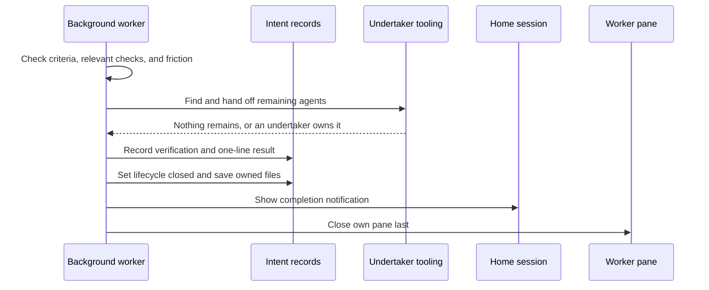

# The autonomous background lane

[Home](../README.md) · [Reading guide](README.md) · [Next: visibility](visibility.md)

The background lane is a herdr session for work an agent can finish without the person's ongoing
participation. Its purpose is to stop autonomous work from competing for the few conversations
that need attention. It combines ordinary agents, explicit task records, operational rules,
recovery tooling, and a finishing protocol. It is not a new kind of model.

## Entry contract

Manual triage asks whether the remaining work needs personal judgment, answers, or back-and-forth.
If it does not, `triage.md` records `lane: background`. Dispatch selects the background session
under the [routing rules](dispatch.md#routing-precedence), remembers the originating home, and
starts the agent with a brief explaining that the person is not watching.

The background lane has no **attention-slot** limit. That means it is exempt from the three/five
interactive workspace count. It does not remove memory, processor, API, subscription, cost,
network, or service limits. It is not fair scheduling or automatic resource admission control.

The dispatcher also checks ownership: an intent belonging to another Linux account cannot be
silently run in this account's background lane. Session separation alone does not isolate
credentials or filesystem permissions; account and infrastructure boundaries are separate.
[Evidence: E-DISPATCH](sources.md#e-dispatch).

## The worker's obligations

An autonomous worker must do more than produce an artifact and leave an offer to continue.
It reads the intent and triage, implements the authorized outcome, checks it, resolves routine
choices, records evidence, and finishes. If it finds a gap, it fixes the gap or creates properly
owned follow-up work. It does not return every judgment to the person simply because choosing is
possible.

Its pinboard has a short story and a current message. At milestones, the message explains where
the work stands and what remains. A running external review is reflected as waiting on that
review; a personal decision is reflected as waiting on Andrew. Clear status is part of the
recovery contract, since a stopped turn under Under way can otherwise look like a dropped run.

No instruction makes an agent omniscient. It can misunderstand scope, trust a weak detector,
misreport progress, or run out of quota. The surrounding mechanisms make those errors easier to
see and repair; they are not proof that autonomous delivery always succeeds.

## Questions are exceptions with a real owner

If a decision genuinely belongs to the person, the worker records friction before asking,
sets its pinboard to waiting Andrew, asks one focused question in its own pane, and waits.
The attention tooling can surface that pane. Waiting on Andrew is a status; a broken service or
missing capability is a blocker and should be described as such.

If the task turns out to need continuing conversation, the workflow calls for shelving it with
a resume record so it can return to the person's session queue. Elapsed time is not an answer,
and background placement is not permission to fabricate consent.

## Completion is an explicit protocol

The order of state/result recording can vary; the essential boundary is that the worker verifies
and saves the real result before closing its own pane. The [wrap skill](sources.md#e-wrap)
provides the operating checklist and calls the concrete closing script.

1. Check every acceptance criterion and the relevant fresh verification output.
2. Confirm this intent has no unresolved open toil it raised, no unanswered approval, and no
   required personal decision. Only the person can accept remaining friction deliberately.
3. Hand unfinished agents to an undertaker when necessary.
4. Update the dated log, mark the intent closed, and record the concise result.
5. Save only owned changes and ensure publication succeeded.
6. Notify the home session and close the worker's own pane as the last operation.

The critical qualification: `ark-state set NNNN closed` itself does **not** check friction,
criteria, or approvals. The agent and wrap policy establish those preconditions. A lifecycle
field set incorrectly can still make tools display Done. [Enforcement matrix](enforcement.md).

## Result visibility after the pane disappears

`ark-state result` stores one line plus a completion date in `intent.md`. It tells the person
what was delivered and where to find it. The home session's shelf displays recent background
results for three days by default. The record and log remain after that display window expires.

The close script posts a notification to the intent's home session when that home is on the
same machine. A home elsewhere falls back to the current session; this is not a general
cross-machine push service. After a short delay it closes the worker pane and, only when no
other ordinary pane remains in the tab, its pinboard drawer. Other conversations are not closed.

Normal automatic wrap removes the pane promptly. A later background dispatch has a fallback
cleanup path for closed background workspaces older than the configured retention. That is
dispatch-triggered housekeeping, not a continuously running garbage collector.
[Evidence: E-STATE, E-SHELF, E-WRAP, E-DISPATCH](sources.md#e-wrap).

## Undertakers: ownership survives the parent

A worker can finish its own intent while agents it started still run. Simply closing would
leave those agents with the person as their accidental supervisor. The wrap skill calls
`ark-undertaker start NNNN` to inspect work left behind.

The tool looks for started intents, children, and helpers that remain relevant. When needed it
creates or uses an undertaker intent in the background lane. That agent takes responsibility
for watching targets, reading their outputs, answering questions whose answers are already
settled, checking delivery, and fixing gaps or creating properly scoped follow-up work.

The undertaker is itself an agent with a task and a skill. It is not an invisible correctness
oracle. Tooling marks watched panes with `watched_by`; attention tooling can leave those panes
to their active watcher. The undertaker waits in the foreground so its own pane should only
need the person's attention for a real decision. If handoff fails, the wrapping agent must not
silently abandon ownership. [Evidence: E-UNDERTAKER](sources.md#e-undertaker).

## Stalled-agent recovery

Unlike the unverified friction reconciliation cadence, stalled-agent recovery has an actual
versioned timer. `ark-stalled.timer` checks approximately every two minutes. The command looks
for a narrow conjunction:

- The pane belongs to the background session and represents the intent's own agent.
- The intent is open in a working lifecycle state.
- herdr reports idle or done rather than a blocked prompt.
- Its state-change sequence has stayed still long enough.
- The pinboard says Under way rather than a legitimate waiting state or blocker.
- An active undertaker is not already watching it.

At the audited defaults, five minutes of eligible inactivity causes one prompt to continue.
If it stays stopped another five minutes, or stalls again within the 60-minute cooldown, the
observer notifies the home session and sets waiting Andrew. It records the action before
attempting the send so an ambiguous timeout does not produce repeated prompts.

This observes state, not transcripts or the meaning of a task. It does not restart an exited
model process in every possible failure mode, solve a quota problem, or prove a worker was
making useful progress. Ordinary interactive sessions are excluded because an agent that just
answered its person may legitimately be idle under Under way.
[Evidence: E-STALLED](sources.md#e-stalled).

For operational failures, see [recovery](recovery.md). For the improvement process that feeds
work into this lane, see [friction reconciliation](reconciliation.md).
