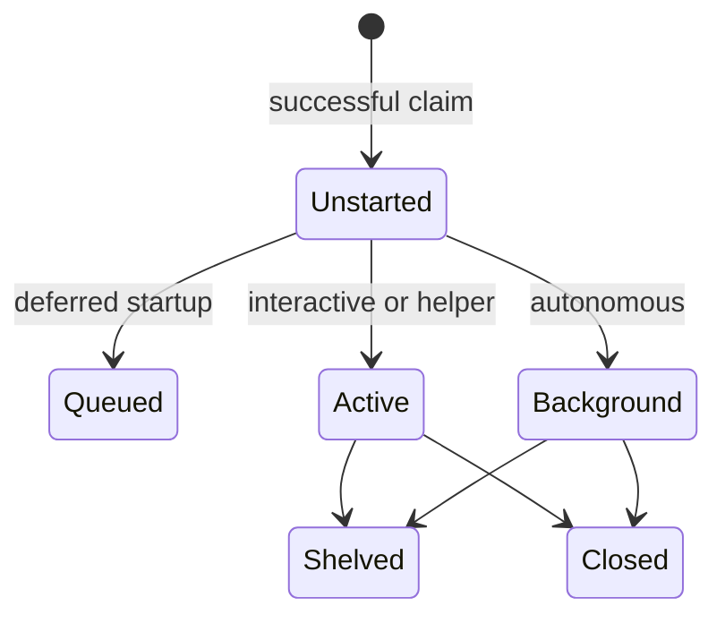

# State, records, and file formats

[Home](../README.md) · [Reading guide](README.md) · [Next: dispatch](dispatch.md)

The durable store is a set of files tracked in Git. Runtime information supplements those
records: a herdr pane can be working while the intent says background, and a pinboard can say
Waiting on Andrew while the intent remains open. These are separate dimensions.

## Four dimensions that should not be collapsed

| Dimension | Examples | Main reader/writer |
|---|---|---|
| Intent lifecycle | `active`, `queued`, `shelved`, `background`, `closed` | `ark-state`, dispatcher, agents |
| Board stage | `backlog`, `plan`, `design`, `build`, `test`, `deploy`, `maintain` | `ark-cards`, Kerdr, explicit reports |
| Attention | Needs the person, waiting on another task, running, blocked, done | Pinboard, herdr, card feed |
| Runtime agent state | Working, blocked at a prompt, idle, done, unknown | herdr and observers |

“In Test” is not a lifecycle transition. “Idle” does not mean accepted or closed. “Waiting on
Andrew” is an attention status, not a special `ark-state` lifecycle value. A card's derived stage
may be a heuristic, while the files still hold the authoritative lifecycle.

## Intent folder

```text
intents/NNNN-slug/
  intent.md       desired outcome and lifecycle metadata
  triage.md       manual assessment and lane
  log.md          dated history and verification
  design.md       optional technical direction requiring review
  spec.md         optional product direction requiring review
  resume.md       handoff required before shelving
  reviews/        preserved review answers when review succeeds
```

Other evidence files may be present when the work requires them. The dispatcher also writes a
local `.brief` containing the agent's task instructions. A generated brief is not the replacement
for the durable intent, triage, and log.

## `intent.md`: current lifecycle lives in its header

The example is fictional. A real number comes from the claim command.

```yaml
---
type: intent
id: 9001
title: Make export failures actionable
priority: normal
short: Explain export failures clearly
story: As a user I want an actionable export error so that I can recover.
stated_by: Andrew
stated_at: 2026-10-23
status: open
state: background
home: example-machine/default
started_by: 9000
---
```

| Field | Meaning and limit |
|---|---|
| `type` | Document kind; `intent` here |
| `id` | Four-digit record identity in the allocator's namespace |
| `title`, `short`, `story` | Full outcome, compact orientation, user story |
| `stated_by`, `stated_at` | Provenance of the request |
| `status` | Human-facing lifecycle; a value beginning with `closed` makes the record closed |
| `state` | Operational placement/lifecycle value |
| `home` | Machine/session to which the work belongs and reports back |
| `parent` | Optional supporting relationship to another intent |
| `started_by` | Optional intent whose agent started this run; supports handoff discovery |
| `waits_on` | Optional prerequisite IDs, commonly a comma-separated scalar |
| `priority` | `high`, `normal`, or `low`; absent/invalid values read as normal |
| `result`, `finished` | One-line background result and completion date |

The shared YAML reader deliberately preserves scalar text, including leading-zero IDs. Use the
shared reader rather than a regex that assumes an unquoted line. In external YAML tools, quote
IDs when required to preserve their representation. Do not rely on generic YAML 1.1 implicit
number conversion for `0010`.

`ark-state get` treats `status: closed` as authoritative over a conflicting `state`. Explicitly
setting any nonclosed state writes `status: open`, reopening the intent. The accepted lifecycle
values are `active`, `queued`, `shelved`, `background`, and `closed`; `none` is a read result for an
intent without a recorded state, not a value accepted by `set`.
[Evidence: E-STATE, E-OKF](sources.md#e-state).

## Lifecycle transitions



The diagram shows initial placement and exits. Interactive closure follows the person's wrap
request; background completion wraps autonomously. Resume and reopen paths are listed separately
to keep its labels readable:

| Starting state | Action | Result |
|---|---|---|
| Queued | Agent dispatches when eligible | Active or background, according to placement |
| Shelved | Agent reads the resume and dispatches | Active or background, according to the remaining work |
| Closed | Explicitly set a nonclosed state | Intent is reopened in that state |

This is the operating lifecycle, not a transition validator. `ark-state set` accepts explicit
state changes; it does not implement a complete finite-state workflow engine. For example, it
does not independently require a resume file before accepting `shelved`, or check friction before
accepting `closed`. Those checks belong to the shelving command and agent skills/policy.

## `triage.md`

```markdown
---
type: triage
title: Export-error triage
lane: background
---

## Outcome
proceed

## Questions and answers
- Is the outcome clear? Yes; failure behavior and verification are specified.
- Will this need Andrew along the way? No; the remaining choices are routine.
- Who labeled it? An agent, manually; record provider/model/effort when known.
```

This is a representative human-readable form. The dispatcher requires that `triage.md` exists
and extracts its background lane; it does not parse every answer to prove the assessment is
correct. Card rendering has its own permissive triage reading, which also accepts an outcome
field. Standardizing prose helps agents, but should not be confused with a deployed judge.

## `log.md`: history, not current state

Logs have no YAML header. Each date has a `## YYYY-MM-DD` heading, newest day first. Within a
day, entries remain in the order they happened. The helper adds under today's heading without
moving old history to the bottom of the file.

```markdown
# Log of intent 9001

## 2026-10-23

- Claimed and manually triaged; no further personal decision is needed.
- Checked unwritable and missing output directories; input remained intact.
- Delivered actionable errors and recorded the background result.

## 2026-10-22

- An earlier illustrative history entry.
```

Use `bin/ark-okf log PATH TEXT`. Older records once stored state in log headers. The state
reader has compatibility handling, and writes migrate those fields into `intent.md`. New
records should use the current format rather than treating the compatibility path as a second
authoritative store. [Evidence: E-OKF](sources.md#e-okf).

## Dependencies

```yaml
waits_on: 9002, 9003
```

`ark-state waits-on` validates that prerequisites exist and refuses self-dependencies and
cycles. Readers also understand a YAML list of text IDs. Resolution searches beside the intent
first, then configured intent roots; this matters when separate stores reuse numeric IDs.
A missing referenced record is unfinished, rather than silently satisfied.

Closing a prerequisite logs the event in affected open intents and can notify the home session
when the last prerequisite closes. It **does not automatically dispatch** the waiting intent.
The queue remains a durable eligibility list that an agent or person can act on.

## Local runtime records

The usual base is `${XDG_STATE_HOME:-$HOME/.local/state}/ark-sdlc/`.

| Relative location | Purpose | Durability boundary |
|---|---|---|
| `taken/<terminal-id>` | Intent adopted through `--self` | Machine-local association; terminal identity avoids reusing a pane number blindly |
| `pin/<id>.message` | Agent's latest concise update | Machine-local; not a Git history substitute |
| `pin/<id>.blockers` | Current problems stopping progress | Machine-local |
| `pin/<id>.status` | Agent-set waiting/under-way status | Bound to current lifecycle; dropped when contradicted |
| `slots/` | Session capacity locks | Coordination, not a durable work queue |
| `stalled/` | Observer records, last check, action history | Machine-local recovery bookkeeping |

Friction cue hits have a separate local log containing time, session ID, and matched cue kinds;
the hook does not log the user's message there. Successful friction cases are durable Git
records. Transcripts and private reports have separate privacy boundaries and are not public
documentation inputs to copy wholesale.

## OKF and Git

Markdown in the private framework follows Open Knowledge Format 0.2 conventions: typed YAML
front matter, with `index.md` and `log.md` using their special forms. The commit hook checks
staged Markdown. It is a format check, not proof of semantic correctness, authorization, or
source truth. See the public [OKF specification](https://github.com/GoogleCloudPlatform/knowledge-catalog/blob/main/okf/SPEC.md).

Git makes records reviewable and shareable. Some commands auto-commit their own file only when
safe; otherwise they leave an edit for the owning agent and say so. Other agents may share the
checkout and index. An agent must never sweep those changes into its own delivery.
[Recovery and shared-copy discipline](recovery.md#shared-working-copy-and-git).

Next: [how dispatch selects a place and starts an agent](dispatch.md).
