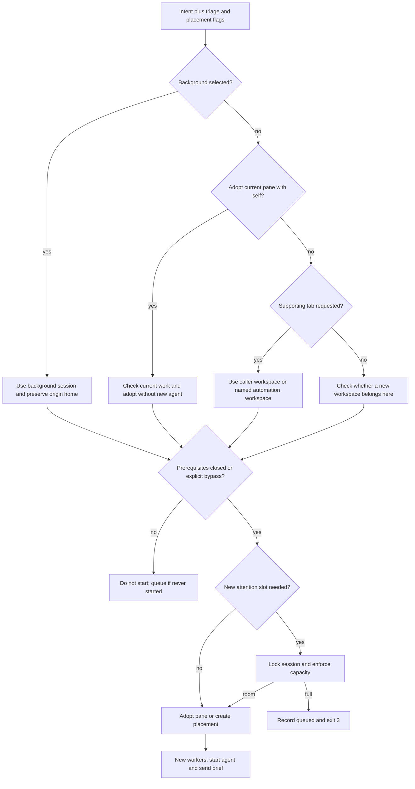

# Dispatch routing and startup

[Home](../README.md) · [Reading guide](README.md) · [Next: autonomous lane](background.md)

`bin/ark-dispatch` connects an intent to a herdr workspace and an agent. It reads configuration,
placement flags, lane metadata, prerequisites, workspace ownership, and session capacity. Its
checks are substantial, but it delegates semantic triage to the agent.
[Evidence: E-DISPATCH](sources.md#e-dispatch).

## Inputs and defaults

The command needs an intent directory containing both `intent.md` and `triage.md`. It normally
runs inside herdr, or receives an explicit session. A short optional label names the agent and
new workspace. Labels are restricted to a lowercase initial letter followed by lowercase
letters, digits, underscores, or hyphens, up to 32 characters.

The audited configuration selects Claude Opus 5.5 at xhigh effort and a configured permission
mode. These are configuration values, not inherent properties of the intent model. A manually
substituted worker can use a different agent. The dispatcher is not documented here as an
automatic cross-provider failover scheduler: a failed startup can still need recovery.

For background and `--here` Claude workers, startup settings disable Remote Control. That keeps
the provider's remote interface focused on conversations the person talks to. It does not
disable local herdr visibility or create a security sandbox.

## Routing precedence

The important branches, in the order needed to understand them, are:

1. Explicit `--background`, or `--session background`, selects the configured background lane.
2. A triage header saying `lane: background` selects that lane when no explicit session is given
   (or `--home` is used), and none of `--here`, `--self`, or `--tab-in` is present.
3. `--here` opens a supporting tab in the caller's workspace.
4. `--self` adopts the intent in the caller's existing pane and starts no agent.
5. `--tab-in LABEL` opens a tab in that labeled workspace, creating it if absent.
6. Otherwise the dispatcher opens a workspace in the selected or caller's session, subject to
   placement and capacity checks.

This is a summary of compatible branches, not a claim that all flags can be combined.
For example, background rejects `--here`, `--self`, and `--tab-in`. `--home` and `--session`
cannot be combined. `--self` needs the caller's herdr pane and cannot use explicit session or
tab placement. A child with `parent` must use `--here`.

`--home NAME` is useful for an intake surface outside a normal herdr conversation: it names the
origin session while allowing a background triage to route the work elsewhere. `--session NAME`
is explicit placement and, unless it names the background session, suppresses automatic routing
from the lane header. A reader should not assume every call with a background header ends up in
background.



The diagram groups validation steps for readability; the source performs compatibility and
environment checks throughout. It does not run triage or approve a design at launch time.

## Work stays where the conversation belongs

Before opening another top-level workspace, the agent inspects the one it is in. If it was
opened for this work, or still has herdr's default folder-derived name and the agent is not
busy with another open intent, it uses:

```sh
bin/ark-dispatch --self intents/9001-export-errors export-errors
```

`--self` checks the current pane's intent association, adopts the record, marks it active,
remembers it by terminal identity, numbers the workspace name, and installs the pinboard.
It does not replace the current process or start another agent. In a person's session, a
workspace that has not taken an intent requires a deliberate `--self` or `--new` decision.

If a workspace already belongs to another open intent, a new independent outcome gets its own
workspace. Supporting tests, reviews, and child work belong in tabs of the existing workspace.
The person should not have to reconstruct one conversation from several top-level spaces.

## Session capacity is about attention

The audited defaults are three ordinary interactive workspaces per session, or up to five after
the person says to start more anyway. Five is the hard ceiling for that dispatch path. Named
automation workspaces and the background session have configured exemptions; helpers do not
consume independent attention slots.

A capacity check takes a session lock so two dispatches cannot both decide the same last slot
is free. Adopting a newly opened workspace with `--self` is checked too. A workspace already
associated with an intent retains its slot instead of being counted as an extra one merely
because its conversation is adopted again.

When full, the dispatcher opens nothing, records `queued` with the home session, prints the
reason, and exits **3**. High priority does not override the limit. An authorized `--override`
raises the applicable ceiling to the configured maximum; it does not mean infinite capacity.
At the maximum, shelving must free a slot first.

This queue is not a self-draining scheduler. The shelf lists eligible work, and an agent can
dispatch it when appropriate. A slot becoming free does not itself guarantee automatic launch.
[Evidence: E-SLOTS, E-SHELF](sources.md#e-slots).

## Dependencies are checked before work is opened

`waits_on` is read through `ark-state`. Unfinished prerequisites prevent startup unless the
person authorized `--no-wait`. A never-started or already queued intent becomes/stays queued;
an intent already carrying another lifecycle state keeps that state when dependency refusal
occurs. The output states exactly what it waits on.

The bypass flags represent the caller's assertion of authorization. The command cannot prove
the person actually said yes. Treat that as [policy supported by a flag](enforcement.md), not
as a complete authorization service.

## Home, execution location, and naming

`home` is `machine/session`: where the work belongs, where the result should be seen, and how
the shelf groups it. A background task executes in the background session but retains its
origin home. When a background task starts another from that lane, the dispatcher can propagate
the initiating intent's nonbackground home on the same machine rather than losing the result
inside an unattended session.

New ordinary workspaces use the last two digits of the ID followed by the label, such as
`01-export-errors` for the fictional `9001`. Those digits repeat; the pinboard and record retain
the full ID. Agents should identify the full intent number when reporting delivery.

The shell receives `ARK_INTENT`. `--self` also has a local per-terminal association because
its already-running process did not start with that environment variable. This is why copying
pane environment variables from one session to another can be dangerous: a short pane ID only
makes sense with its session/socket context.

## Startup handshake and partial failure

The dispatcher checks client/server compatibility, ensures the background session is running
when necessary, creates a placement without focusing it, and asks herdr to start the configured
agent. It then sends a brief containing the intent path, operational rules, pinboard duties,
and background finishing instructions where applicable.

The background server can be started as an independent transient user service. That separates
its lifetime from another service's restart, but does not survive arbitrary machine or account
failure without the usual recovery work.

If agent startup fails, a workspace may already exist. The dispatcher marks the intent as
started (`active` or `background`) and reports that the agent was not ready, often because of a
login or trust prompt. It does not claim startup was rolled back. Recovery should inspect that
pane and avoid blindly launching a duplicate worker.

Pinboard setup and some bookkeeping calls are deliberately best effort so a note failure does
not abort otherwise useful work. Their warnings still need attention. A dispatch exit of zero
means its launch path completed; it does not establish that the agent later finished the task.

## Examples of placement choices

| Situation | Appropriate shape | Why |
|---|---|---|
| Current conversation is for the new task | `ark-dispatch --self DIR LABEL` | Continue in place |
| Independent work and current space belongs to another task | `ark-dispatch --new DIR LABEL` | Separate top-level conversation |
| Task can finish autonomously | Background triage, then ordinary dispatch, or explicit `--background` | Route out of the attention-limited sessions |
| Supporting child | `ark-dispatch --here CHILD-DIR LABEL` | Keep support in the parent's workspace |
| Repeated approved automation | `--tab-in LABEL` with session as needed | One automation workspace, one tab per run |
| External intake that names an origin session | `--home NAME` | Preserve home while honoring background triage |

These are patterns for agents inside the configured environment, not copy-and-run installation
instructions for readers of this repository. [Full command reference](commands.md).
