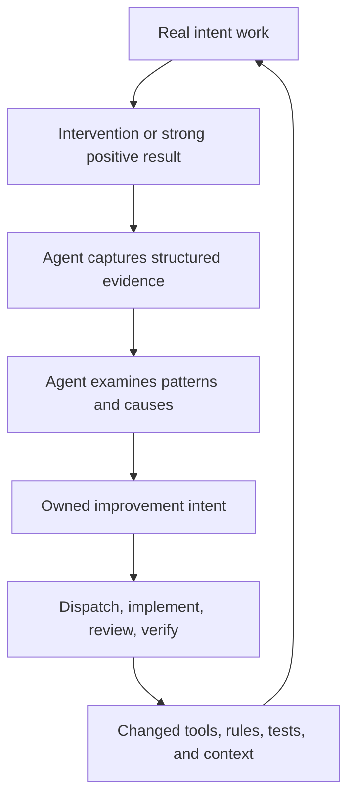

# The improvement flywheel

[Home](../README.md) · [Reading guide](README.md) · [Next: review and verification](reviews.md)

The flywheel is the repeated conversion of normal work into improvements to how future work
runs. A person's correction already costs attention; capturing it makes that cost useful beyond
the immediate fix. Autonomous dispatch then provides a way to carry improvements through
implementation without turning each one into another long personal conversation.

This is an operating pattern supported by several tools, not a single `flywheel` executable or
a claim that the system has proved a numerical productivity multiplier.
[Evidence: E-FLYWHEEL](sources.md#e-flywheel).

## The complete loop

The compounding part is the final arrow. A fix to shared startup instructions, a checked command,
a routing rule, or a regression test can change many later runs. A one-off answer that never
enters the operating system has a smaller effect, even when it solves the immediate problem.

## What can carry an improvement forward

| Carrier | Useful for | Failure mode |
|---|---|---|
| Global personal instructions | Stable preferences for working with the person | Rules can become long, conflicting, or ignored |
| Project rules and context | Workflow obligations and lasting local decisions | Stale copies or missing startup loading |
| A skill | A repeatable multistep operation, such as wrap | The agent may skip a step or apply it out of scope |
| A command | Repeated mechanics with explicit output and failure semantics | A green command can still measure the wrong outcome |
| Regression cases | A known failure that should remain fixed | Tests can overfit wording or mirror implementation |
| A review | Independent challenge before delivery | Reviewer quota, missing context, or weak findings |
| Durable intent/log evidence | Why the change exists and how it was checked | An unsupported “done” entry can mislead later agents |

The existing process uses all of these. They complement one another. A command can enforce
capacity under a lock; a sentence in a rule cannot provide the same race protection. An agent
must still decide whether the person authorized an override; a lock cannot decide that.

## Positive evidence: epic wins

Friction records what went wrong or required intervention. A parallel practice records strong
positive feedback as an **epic win**. It is more than an ordinary thanks: the person says the
result was exactly right, especially useful, or meaningfully changed how they work.

`ark-win` provides a draft, validates its shape, allocates a `W-NNNN` ID, and publishes the record.
The fields distinguish what was delivered from what made it work. Work type and tags make later
comparison possible. The same prompt-check machinery can remind the agent when positive cues
appear; friction and win reminders can both apply to one message.

Those records live in a private personal knowledge bundle. This handbook publishes the format
and mechanism, not the person's praise, transcripts, or case details. A safe
[fictional win draft](../examples/win-draft.md) shows the idea without exposing private evidence.
[Evidence: E-WINS](sources.md#e-wins).

Wins are material for later analysis, not an automatically trained preference model. Recording
them creates a structured opportunity to learn; it does not prove an unattended miner or policy
optimizer is running.

## Reviews and experiments feed the loop differently

A review challenges a concrete artifact or change. A retrospective compares runs or patterns.
An experiment tests whether a proposed next improvement is promising. They can all inform an
intent, but none should be described as deployed runtime behavior just because a report exists.

The historical decision-replay work associated with intent 0143 was an experiment about whether
past decisions could usefully predict future ones, together with exploratory checks of friction
remedies. It did **not** become deployed automation for deciding on the person's behalf. Its
private report, datasets, transcripts, numerical findings, and sensitive examples are not
republished here.

Similarly, the review judge remains planned. Manual triage records are intended to be useful
seed cases for its eventual evaluation, but that intended future use is not evidence of a
working judge today. [Evidence: E-EXPERIMENTS, E-TRIAGE](sources.md#e-experiments).

## How the loop stays honest

The strongest evidence is behavioral: a later run encounters the old trigger and handles it
without the avoidable intervention. A test, installed change, and relevant detector support
that observation. A case reopening a remediated entry challenges it.

The weakest version of the loop would be “record a complaint, add a rule, mark it fixed.” The
existing workflow supplies better tools, but agents must still connect evidence to outcomes.
That is why reconciliation investigates root cause and why completion requires more than
editing status metadata.

Useful distinctions when reading any claim about improvement:

- **Observed procedure:** an agent created work from evidence and delivered a remedy.
- **Implemented mechanism:** code performs a defined operation such as reopening a case.
- **Configured operation:** a particular installation or timer is present and enabled.
- **Measured outcome:** a check establishes a bounded result under stated conditions.
- **Hypothesis:** a proposed future mechanism could improve the process.

This handbook identifies those levels in its [source map](sources.md) and
[policy/code matrix](enforcement.md). It does not infer universal agent reliability from one
successful run or turn an unverified schedule into an operational guarantee.
