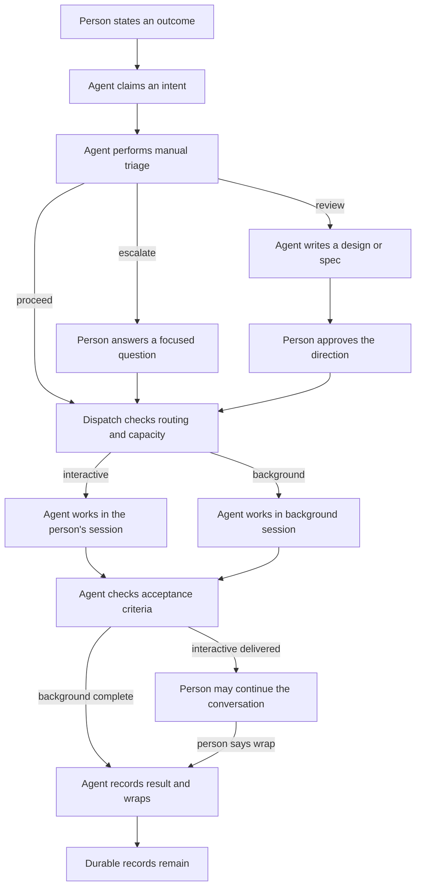
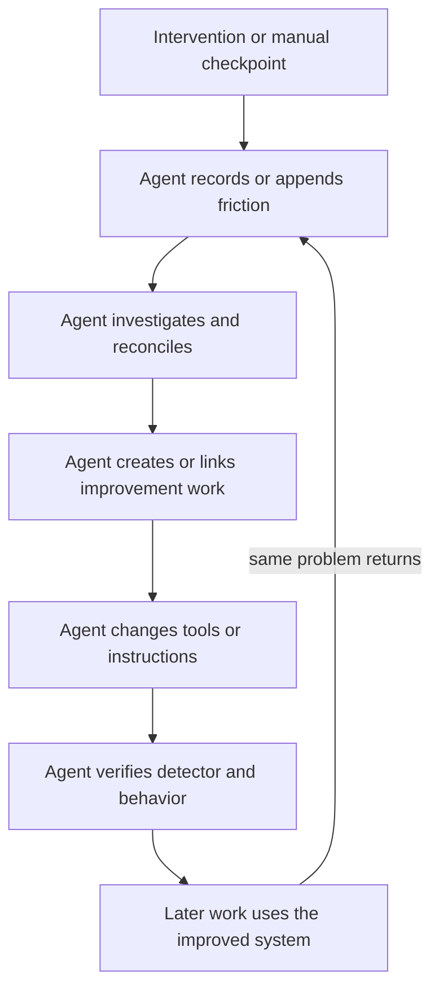

# The system at a glance

[Home](../README.md) · [Reading guide](README.md) · [Next: intents](intents.md)

The scarce resource is the person's attention. The system gives agents a durable description of
the desired outcome, a place to work, and a way to report what happened. Work that can finish
without further personal decisions runs in a separate background session. The person sees
questions and results through the terminal environment and its board.

The branching decisions are made by an agent following written rules. The dispatcher performs
concrete checks and starts work; it does not contain the planned review judge.
[Evidence: E-RULES, E-INTAKE, E-DISPATCH](sources.md#e-rules).

## Five pieces, each with a different job

| Piece | Job | What it does not establish |
|---|---|---|
| Intent files | Desired outcome, acceptance criteria, lifecycle, history | That the work really passed its checks |
| Agent instructions and skills | How agents triage, work, capture friction, and finish | A mechanically enforced gate for every rule |
| Shell and Python commands | Claim IDs, dispatch, update state, publish records, render feeds | Human taste or authorization inferred from a command succeeding |
| herdr | Sessions, workspaces, tabs, panes, agent startup and prompts | An intent tracker independent of the files |
| [Kerdr](https://github.com/drewdunne/kerdr) | A board combining records and live workspace information | An autonomous decision maker or replacement for herdr |

The private framework is the workflow glue. Kerdr is a public tool that can consume other work
trackers through its [feed and action contract](https://github.com/drewdunne/kerdr/blob/main/docs/feed.md).
This repository publishes the explanation, not a runnable distribution of all the glue.

## The second loop: improve the way work happens

An interruption is treated as evidence. If a person has to remind an agent to do something it
already should have done, or perform a step the agent should have handled, the agent records
friction. A purposeful decision checkpoint can also be recorded, but classified differently.

That is the **flywheel**: operational evidence feeds work that changes future operations. It is a
combination of agent judgment, instructions, commands, tests, and durable records. A prompt hook
does not itself diagnose the problem or dispatch a fix. No dedicated friction reconciler daemon
or verified reconciliation schedule was established by this audit.
[Evidence: E-FRICTION, E-PREFLIGHT, E-RECONCILIATION](sources.md#e-friction).

## What exists, and what is still an idea

| Capability | Audited status |
|---|---|
| File-based intents and manual triage | Operating |
| Dispatch into interactive or background herdr sessions | Implemented |
| Session capacity checks, dependencies, shelf, pinboards | Implemented |
| Friction reminders, case capture, detector execution | Implemented |
| Agent-led friction investigation and improvement intents | Existing operating procedure |
| Automatic background wrap and handoff to an undertaker | Agent policy supported by commands and skills |
| Background stalled-agent check | Implemented timer and command; narrow eligibility rules |
| Cross-provider review runner | Implemented; availability depends on quota and runtime |
| Kerdr board and optional action adapters | Public tool and private adapter implementation |
| Review judge and future decision services | Planned |
| General automation of the person's decisions | Not deployed; replay work was experimental |
| A verified cadence for friction reconciliation | Unverified |

The chapters explain the qualifications behind this table. In particular, a status of `closed`
does not prove a friction check ran, a board column is not a lifecycle state, and an unlimited
background lane is not unlimited compute.

Continue with [intents and triage](intents.md), or jump directly to
[friction reconciliation](reconciliation.md).
