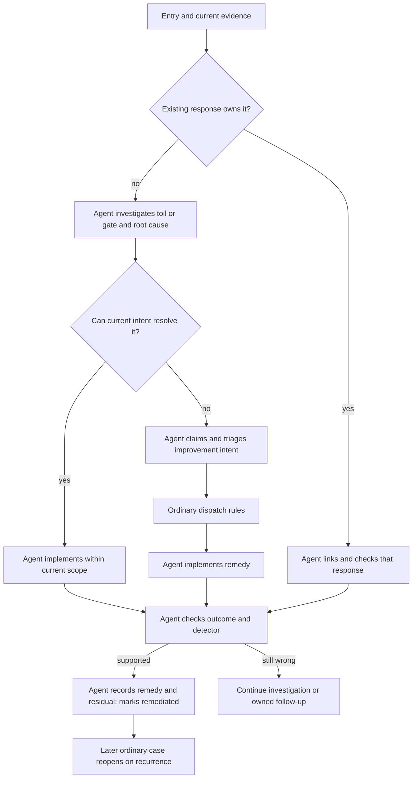

# Friction reconciliation: from evidence to owned work

[Home](../README.md) · [Reading guide](README.md) · [Next: flywheel](flywheel.md)

**Capture records an occurrence. Reconciliation determines what it means for the system and
what work owns the response.** The existing process is agent-led: agents inspect records and
behavior, connect repeated problems, create or link improvement intents, carry out authorized
remedies, and check whether the evidence now supports remediation.

This chapter synthesizes those existing rules and observed agent actions into one operational
walkthrough. It does not describe a newly implemented reconciler service or reproduce a private
automation prompt. [Evidence: E-RECONCILIATION](sources.md#e-reconciliation).

## What the source audit did and did not establish

The repository has friction creation, case capture, cue checking, detector execution, intent
creation, dispatch, and state tools. It also has a concrete stalled-agent timer. The inspected
repository and local/server user-timer inventories did **not** contain a dedicated friction
reconciler binary or systemd timer. Inspection of available external task metadata did not
establish a reconciliation schedule either.

Therefore the accurate claim is: **agent-led reconciliation exists; its scheduling cadence is
unverified in this audit.** It may be initiated by a conversation, an agent already working, an
undertaker, or an external automation. Absence of a versioned scheduler is not proof that no
reconciliation happens. Conversely, evidence that agents do this work is not proof that a
particular hourly or daily scheduler is deployed.

The distinction matters operationally. Someone reproducing the pattern must arrange their own
trigger or adopt the work into an existing agent run. This handbook cannot promise that an open
entry will be picked up within a fixed interval.

## The inputs to reconcile

| Input | What it contributes | What it cannot decide by itself |
|---|---|---|
| Friction entry | Problem category, kind, status, remedy, residual | Whether the text is complete or still accurate |
| Cases | Recurrence, intervention wording, attribution | The underlying technical cause |
| Detector output | A repeatable signal about a condition | Whether that condition fully represents the problem |
| Intent and log | Existing ownership, scope, delivered work, verification | Whether a separate new task is necessary |
| Current instructions/tools | What agents are supposed to do and what code enforces | Whether agents reliably comply |
| Live environment | Whether a fix is installed and usable | A public-safe explanation of private operations |

The reconciliation step reasons across those sources. It should not turn a stale status field
or one green command into a final judgment without checking the current behavior.

## 1. Establish current truth

The agent starts from an updated checkout and reads the entry, cases, related intents, and
relevant detector output. It searches for the same problem before making another category.

Preflight gives a broad inventory. A targeted detector run can supply the detail suppressed by
preflight. Since detectors may inspect machine-local state, the agent establishes where the
problem and remedy actually live. A command failing on a machine that never had the feature is
different from a regression on its intended machine.

At this point the agent distinguishes at least four possibilities:

- The problem is still present and lacks an adequate remedy.
- A remedy exists in source but has not reached the place where it is used.
- The remedy works, but the detector or status is stale or measures the wrong condition.
- A new occurrence shows that a previously claimed remedy did not hold.

These lead to different tasks. Automatically interpreting every FAIL as “write another fix”
would create duplicate work and hide deployment or measurement problems.

## 2. Separate avoidable work from deliberate checkpoints

Toil should be removed where possible. A gate should be preserved if it represents a real
personal decision, password, physical action, or intentional boundary. The improvement for a
gate is often preparation: collect evidence, make the exact decision clear, and reduce the
manual action to what only the person can do.

The agent does not change an entry to accepted just to make closure easier. That is the
person's decision. It also does not reinterpret every authorization boundary as toil merely
because an automated path would be faster.

For a fictional example, “the person runs a read-only status command because the agent did not
try it” is different from “the person approves the public wording of a message to someone else's
repository.” Both cost attention; only the first is necessarily a step the agent should absorb.

## 3. Find the failure at the right layer

| Failure layer | Example of a suitable remedy |
|---|---|
| Missing capability | Add a command or adapter with a checked output contract |
| Fragile operational procedure | Centralize the operation and its recovery path |
| Incorrect routing | Repair lane or workspace selection and test the refusal cases |
| Rule not loaded | Fix startup/context installation and verify a fresh session |
| Rule loaded but ignored | Strengthen behavior instructions and test realistic agent behavior |
| Bad detector | Replace a textual proxy with an outcome-oriented check |
| Unclear personal decision | Prepare a concise, evidence-backed question rather than guessing |

Changing a sentence is cheap, but sometimes insufficient. Adding a command is stronger for
repeatable mechanics, but cannot replace judgment about user intent. Reconciliation chooses a
remedy that addresses the cause the evidence supports, then states what remains uncertain.

## 4. Give the response durable ownership

If the current intent can resolve the problem within scope, it can own the remedy. Otherwise
the agent links existing work or claims an improvement intent with its own criteria, constraints,
and triage. It avoids both leaving an actionable gap in prose and dispatching duplicate fixes.

The ordinary intake rules still apply. A supporting child gets `parent` and a helper tab; a
new independent improvement gets the appropriate top-level placement. Work that can finish
without the person gets background triage, rather than filling an interactive slot by habit.
Dependencies belong in `waits_on` when the work truly cannot start first.

The friction file's `intent` identifies associated work, but the files do not form a relational
database with automatic bidirectional integrity. Agents should record the connection clearly in
the remedy and intent log. A source inspection cannot infer ownership merely because two titles
sound similar.

## 5. Dispatch and implement through the normal workflow

Once triage is settled, the agent uses the existing dispatcher. Capacity checks, dependency
checks, review policy, privacy, and authority do not disappear because the trigger was friction.
There is no separate privileged reconciliation path.

A background worker then implements and verifies its improvement. If it starts more agents,
their ownership must survive its wrap through the undertaker mechanism. The observed operating
history includes agents creating improvement intents from friction and routing them into the
background lane; that is evidence for this connection, without publishing the private cases.

## 6. Reconcile status against verification

The remedy is ready to be marked remediated when the agent can describe the lasting change,
show the relevant check, and explain any residual manual work. A passing detector helps, but it
is not the entire acceptance criterion.

For example, a fictional fix for forgotten output-folder diagnosis might require a test of the
error message, the exit status, and input preservation. A detector that only searches the source
for “permission denied” would be too weak: those words could exist while the executable still
discards useful context or modifies the input.

If the remedy is already working but the entry remains open, the agent updates the record with
evidence instead of inventing new engineering work. If a check fails for an unrelated baseline
condition, it states that limitation honestly. The reconciliation action and verification are
logged in the owning intent.

## 7. Let recurrence challenge the remedy

Normal case capture reopens a remediated entry when the problem returns. That makes remediation
falsifiable. A reopened case can mean the earlier fix was incomplete, not installed everywhere it
belonged, misunderstood, or measured badly. The next investigation should use that evidence
rather than merely restoring the old green status.

`--past` is specifically for historical cases preceding the fix; it preserves the current
status. It is not a loophole for avoiding recurrence. `--missed` records that the person had to
point out the failed capture itself. [Case semantics](friction.md#appending-cases-and-publication-semantics).

## The boundary to remember

Neither `ark-friction check` nor `friction/preflight.sh` performs this whole procedure. Neither
automatically creates a fix intent. The dispatcher does not mine friction on its own. The
stalled-agent timer prompts eligible stopped background workers, not arbitrary unresolved
friction entries. Those distinctions preserve the existing system's actual shape and prevent
an explanatory diagram from quietly inventing a daemon.
